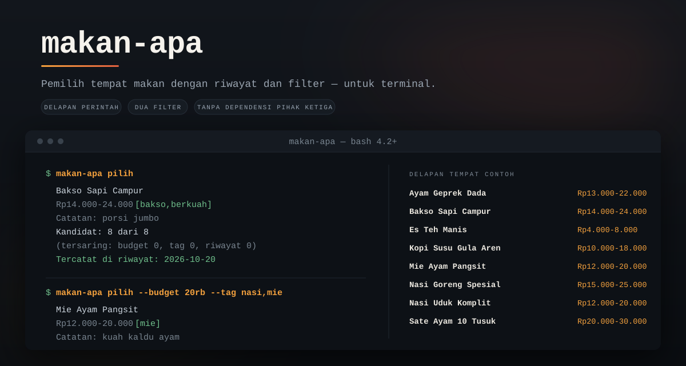

<p align="center">
  
</p>

<p align="center"><b>Pemilih tempat makan dengan riwayat dan filter — untuk terminal.</b></p>
<p align="center">Delapan perintah, dua filter, dan riwayat yang mencegah pilihan berulang. Satu skrip Bash tanpa dependensi pihak ketiga.</p>

<p align="center">
  
  
  
  
</p>

<p align="center">
  <a href="#masalah">Masalah</a> ·
  <a href="#fitur">Fitur</a> ·
  <a href="#cara-kerja">Cara Kerja</a> ·
  <a href="#demo">Demo</a> ·
  <a href="#instalasi">Instalasi</a> ·
  <a href="#pakai-dalam-5-baris">Menjalankan</a> ·
  <a href="#konfigurasi">Konfigurasi</a> ·
  <a href="#struktur-proyek">Struktur</a> ·
  <a href="#pembagian-tugas">Pembagian Tugas</a> ·
  <a href="#keterbatasan">Keterbatasan</a>
</p>

---

## Masalah

Di grup chat, "makan apa?" muncul hampir setiap hari. Jawabannya berputar-putar: orang
menawarkan tempat yang sama, atau harganya tidak cocok, atau yang kemarin sudah dimakan.
Tidak ada satu tempat yang mengingat keputusan bersama.

**makan-apa** mengingat daftar tempat makan, lalu memilih satu secara acak setelah menyaringnya
dengan budget dan tag. Tempat yang dipilih dalam beberapa hari terakhir tidak muncul lagi, jadi
hasilnya tidak berulang — "ayam geprek lagi" tiga hari berturut-turut tidak terjadi.

Semua data berupa TSV di direktori XDG pengguna: bisa dibuka di editor teks, dicadangkan, dan
dibagikan ke teman lewat `daftar --tsv` + `impor`.

## Fitur

**Perintah**

| Perintah | Argumen | Opsi |
|---|---|---|
| `init` | — | `--paksa` |
| `tambah` | `NAMA` | `--harga` (wajib), `--tag`, `--catatan` |
| `daftar` | — | `--tag`, `--budget`, `--ketat`, `--tsv` |
| `ubah` | `NAMA` | `--nama-baru`, `--harga`, `--tag`, `--catatan` |
| `hapus` | `NAMA` | — |
| `pilih` | — | `--budget`, `--ketat`, `--tag`, `--hari`, `--dry-run`, `--ulang` |
| `riwayat` | — | `--hari`, `--semua` |
| `impor` | `BERKAS` | `--ganti` |

**Yang membuat perlu dipakai**

- **Riwayat** — tempat yang dipilih dalam *N* hari terakhir tidak muncul lagi. *N* diambil dari
  `--hari N`, lalu `riwayat_hari` di berkas konfigurasi, lalu nilai bawaan **3**.
- **Filter budget dan tag** — `--budget` dibandingkan dengan `harga_min`; `--ketat`
  dibandingkan dengan `harga_max`, sehingga hanya tempat yang seluruh rentangnya muat dalam
  budget yang lolos.
- **Kandidat yang bisa dijelaskan** — bila semua tempat gugur, program mencetak berapa yang gugur
  karena budget, tag, dan riwayat, lalu memberi saran melonggarkan filter. Tidak diam, tidak
  menglonggarkan filter sendiri.
- **Keputusan yang bisa diulang** — `--ulang` mengganti pilihan hari ini alih-alih mencatat dua
  kali; `--dry-run` mencoba tanpa mengotori riwayat.
- **Data yang bisa dibagikan** — `daftar --tsv` untuk ekspor, `impor` untuk impor. Satu baris
  tidak valid membatalkan seluruh impor, jadi daftar tidak pernah setengah jadi.

## Cara Kerja

**Riwayat** — `--hari 0` mematikan penyaringan riwayat. Jendela *N*=3 berarti hari ini, kemarin,
dan kemarin lusa; catatan yang berumur tepat tiga hari sudah tidak memblokir. `--ulang` mengganti
pilihan hari ini, bukan menambah baris kedua; bila hari ini belum ada pilihan, `--ulang` mencatat
pilihan baru dan memberitahukannya.

**Filter** — penyaringan berjalan sebelum pengacakan, dengan urutan budget → tag → riwayat.
Tag menerima beberapa nilai yang dipisah koma, dan sebuah tempat lolos bila punya salah satu
tag tersebut.

**Harga** — `--harga` menerima `25000`, `25rb`, `25k`, atau `25.000`, dan bentuk `MIN-MAKS`
untuk rentang. `harga_max` disamakan dengan `harga_min` bila hanya satu nilai diberikan.

**Opsi kosong vs tidak diberikan** — `--tag ""` mengosongkan tag, `--catatan ""` mengosongkan
catatan, dan keduanya berbeda dari tidak menuliskan opsi itu sama sekali.

## Demo

Keluarannya dapat diulang persis. Tanggal dipalsukan lewat `MAKAN_APA_TANGGAL` dan sumber acak
dikunci lewat `MAKAN_APA_SEED=11`:

```console
$ export MAKAN_APA_DATA_DIR=/tmp/makan-apa-demo
$ makan-apa init
Data contoh disalin ke /tmp/makan-apa-demo/tempat.tsv (8 tempat).
Jalankan 'makan-apa pilih' untuk mencoba.

$ MAKAN_APA_TANGGAL=2026-10-18 makan-apa pilih
Bakso Sapi Campur
  Rp14.000-24.000  [bakso,berkuah]
  Catatan: porsi jumbo
  Kandidat: 8 dari 8 (tersaring: budget 0, tag 0, riwayat 0)
  Tercatat di riwayat: 2026-10-18

$ MAKAN_APA_TANGGAL=2026-10-19 makan-apa pilih
Nasi Goreng Spesial
  Rp15.000-25.000  [nasi,cepat]
  Catatan: porsi besar
  Kandidat: 7 dari 8 (tersaring: budget 0, tag 0, riwayat 1)
  Tercatat di riwayat: 2026-10-19

$ MAKAN_APA_TANGGAL=2026-10-20 makan-apa pilih
Es Teh Manis
  Rp4.000-8.000  [minuman]
  Catatan: gelas besar
  Kandidat: 6 dari 8 (tersaring: budget 0, tag 0, riwayat 2)
  Tercatat di riwayat: 2026-10-20

$ MAKAN_APA_TANGGAL=2026-10-20 makan-apa riwayat --hari 3
TANGGAL     NAMA
2026-10-20  Es Teh Manis
2026-10-19  Nasi Goreng Spesial
2026-10-18  Bakso Sapi Campur
3 catatan (3 hari terakhir).

$ MAKAN_APA_TANGGAL=2026-10-20 makan-apa pilih --ulang --budget 20rb --ketat
Nasi Uduk Komplit
  Rp12.000-20.000  [nasi]
  Catatan: telur balado
  Kandidat: 3 dari 8 (tersaring: budget 4, tag 0, riwayat 1)
  Mengganti pilihan 2026-10-20: Es Teh Manis -> Nasi Uduk Komplit

$ MAKAN_APA_TANGGAL=2026-10-20 makan-apa riwayat --hari 1
TANGGAL     NAMA
2026-10-20  Nasi Uduk Komplit
1 catatan (1 hari terakhir).
```

Yang tetap berapa pun sumber acaknya: jumlah kandidat turun satu per hari karena jendela riwayat,
dan `--ulang` mengganti baris hari ini alih-alih menambah baris kedua. Tanpa `MAKAN_APA_SEED`,
`pilih` memakai `/dev/urandom`.

Skrip demo yang menghasilkan transkrip di atas ada di [`demo/demo-2-menit.sh`](demo/demo-2-menit.sh).
Jalankan dengan `make demo`, atau simpan keluarannya:

```bash
bash demo/demo-2-menit.sh > demo.txt
```

## Instalasi

### Prasyarat

- Ubuntu 24.04 LTS (target utama), juga diuji di Ubuntu 22.04
- bash 4.2 atau lebih baru
- `flock` (util-linux) untuk mengunci data saat menulis
- `tzdata` — satu-satunya dependensi eksplisit paket

Periksa versi bash yang dipakai:

```bash
bash --version | head -1
```

### Dari halaman Releases

Unduh `makan-apa_0.1.1_all.deb` dari
[halaman rilis v0.1.1](https://github.com/Ivanadrian31/MakanApa/releases/tag/v0.1.1), lalu pasang:

```bash
sudo apt install ./makan-apa_0.1.1_all.deb
```

Alternatif tanpa `apt`:

```bash
sudo dpkg -i makan-apa_0.1.1_all.deb
```

### Verifikasi pemasangan

```bash
makan-apa --version
```

```console
$ makan-apa --version
makan-apa 0.1.1
```

Buka halaman manualnya dengan `man makan-apa`.

### Mencoba tanpa memasang

Paket `.deb` bisa dibuka ke direktori mana pun. Pustakanya dicari relatif terhadap tempat skrip
berada, jadi struktur hasil ekstrak langsung bisa dipakai:

```bash
mkdir -p ~/coba-makan-apa
dpkg-deb -x makan-apa_0.1.1_all.deb ~/coba-makan-apa
MAKAN_APA_DATA_DIR=/tmp/coba ~/coba-makan-apa/usr/bin/makan-apa init
```

### Melepas paket

Data pengguna tidak ikut terhapus, jadi melepas paket tidak menghapus daftar dan riwayat:

```bash
sudo apt remove makan-apa
```

## Pakai dalam 5 baris

Lima perintah ini langsung bisa diikuti setelah pemasangan:

```bash
makan-apa init
makan-apa tambah "Soto Betawi" --harga 18rb-28rb --tag soto
makan-apa pilih
makan-apa pilih --budget 20rb --tag nasi,mie
makan-apa riwayat --hari 7
```

`init` menyalin delapan tempat contoh ke direktori data. Perintah `tambah` menambah satu tempat
baru, jadi setelahnya daftarnya berisi sembilan dan angka kandidat ikut naik menjadi *9 dari 9*.

Untuk menjalankan dari repo, bukan dari paket:

```bash
./bin/makan-apa init
```

## Konfigurasi

Semua data pengguna tinggal di direktori XDG, dan tidak ada yang ditulis ke `/usr` saat runtime.

| Berkas | Lokasi | Isi |
|---|---|---|
| daftar tempat | `~/.local/share/makan-apa/tempat.tsv` | 5 kolom TAB: nama, `harga_min`, `harga_max`, tag, catatan |
| riwayat | `~/.local/share/makan-apa/riwayat.tsv` | 2 kolom: tanggal `YYYY-MM-DD` dan nama |
| kunci | `~/.local/share/makan-apa/.kunci` | berkas kosong untuk `flock` |
| konfigurasi | `~/.config/makan-apa/config` | `kunci=nilai` |

Program **tidak** memakai berkas `.env`. Konfigurasi dibaca dari berkas `config` dengan format
`kunci=nilai`; satu kunci dikenali, yaitu `riwayat_hari` (0–365), yang menetapkan jendela riwayat
dalam hari. Nilai 0 mematikan penyaringan riwayat:

```bash
mkdir -p ~/.config/makan-apa
printf 'riwayat_hari=3\n' > ~/.config/makan-apa/config
```

### Variabel lingkungan

Semua variabel Opsional — program berjalan tanpanya.

| Variabel | Kegunaan |
|---|---|
| `MAKAN_APA_DATA_DIR` | direktori data, menggantikan lokasi XDG |
| `MAKAN_APA_CONFIG_DIR` | direktori konfigurasi |
| `MAKAN_APA_TANGGAL` | memalsukan tanggal hari ini, format `YYYY-MM-DD` |
| `MAKAN_APA_SEED` | benih acak, membuat pemilihan dapat diulang |
| `MAKAN_APA_CONTOH` | lokasi berkas contoh untuk `init` |
| `MAKAN_APA_LIB` | lokasi direktori `lib/` berisi pustaka program |

`MAKAN_APA_TANGGAL` dan `MAKAN_APA_SEED` berguna untuk mencoba perilaku yang tidak bisa
dibuktikan pada hari yang sama, misalnya efek jendela riwayat. Seed yang sama, daftar kandidat
yang sama, dan urutan yang sama menghasilkan pilihan yang sama.

### Format berkas

`tempat.tsv`: baris komentar diawali `#`, kolom dipisah satu TAB, dan akhiran `\r` dari berkas
yang pernah diedit di Windows dibuang. Baris yang rusak dilewati dengan peringatan; kalau tidak
ada satu pun baris valid, program keluar dengan kode 3.

```text
# data contoh makan-apa - silakan diedit
# nama<TAB>harga_min<TAB>harga_max<TAB>tag<TAB>catatan
Nasi Goreng Spesial	15000	25000	nasi,cepat	porsi besar
Mie Ayam Pangsit	12000	20000	mie	kuah kaldu ayam
```

Cadangan cukup menyalin kedua berkas TSV. Riwayat sengaja tidak ikut diekspor, karena riwayat
adalah keputusan pribadi. Untuk berbagi daftar dengan teman:

```bash
makan-apa daftar --tsv > daftar-makan.tsv
makan-apa impor daftar-makan.tsv
```

Menghapus data pengguna sepenuhnya:

```bash
rm -rf ~/.local/share/makan-apa ~/.config/makan-apa
```

## Tech Stack

| Lapisan | Teknologi |
|---|---|
| Bahasa | Bash 4.2+, tanpa dependensi pihak ketiga |
| Antarmuka | CLI; `stdout` untuk data, `stderr` untuk pesan dan ringkasan |
| Penyimpanan | Berkas TSV di direktori XDG, ditulis atomik dengan `mv -f` |
| Penguncian | `flock` pada berkas kunci, dilepas otomatis |
| Pengemasan | Paket Debian `.deb` (`Architecture: all`) |
| Dokumentasi | Halaman manual `man` (roff) dan bash completion |
| Pengujian | bats-core; `shellcheck` untuk analisis statis |
| CI | GitHub Actions di Ubuntu 24.04 dan 22.04 |

## Struktur Proyek

```text
makanApa/
├── bin/makan-apa          # entry point: parsing opsi dan dispatch
├── lib/                   # pustaka, hanya definisi fungsi
│   ├── umum.sh            # die, validasi, kunci, tulis atomik
│   ├── harga.sh           # parse_harga, format_harga
│   ├── data.sh            # baca/tulis tempat, riwayat, konfigurasi
│   ├── saring.sh          # penyaringan, diagnosis, pengacakan
│   ├── cmd-dasar.sh       # init, tambah, daftar, hapus
│   ├── cmd-pilih.sh       # pilih
│   ├── cmd-riwayat.sh     # riwayat
│   ├── cmd-impor.sh       # impor
│   └── cmd-ubah.sh        # ubah
├── data/contoh.tsv        # delapan tempat contoh
├── debian/                # metadata paket: control, changelog, copyright
├── man/makan-apa.1        # halaman manual
├── completions/makan-apa  # bash completion
├── demo/demo-2-menit.sh   # skrip demo yang dapat diulang
├── tests/                 # bats-core + helper + uji pasang bersih
├── assets/                # banner README
└── Makefile               # target: check, man, deb, lint, demo
```

## Pembagian Tugas

Proyek ini dikerjakan dua orang: **A** menangani inti skrip dan infrastruktur, **B** menangani
paket, dokumen, dan administrasi repo. Pembagian di bawah diturunkan dari riwayat commit
di repo (`git log --author`, `git shortlog -sn`) dan berkas yang masing-masing sentuh.

| Anggota | Peran | Tanggung jawab / modul | File atau folder terkait |
|---|---|---|---|
| [bimadji](https://github.com/bimadji) (Bima Adji Kusuma) | A — inti skrip dan infrastruktur | Entry point dan parsing opsi; pustaka dasar, harga, data, dan penyaringan; perintah `init`, `tambah`, `daftar`, `hapus`, `pilih`; CI; helper dan sebagian besar test suite | `bin/makan-apa`, `lib/umum.sh`, `lib/harga.sh`, `lib/data.sh`, `lib/saring.sh`, `lib/cmd-dasar.sh`, `lib/cmd-pilih.sh`, `data/contoh.tsv`, `Makefile`, `.github/workflows/ci.yml`, `tests/helper.bash`, `tests/cli.bats`, `tests/tambah.bats`, `tests/daftar.bats`, `tests/pilih.bats`, `tests/data.bats` |
| [Ivanadrian31](https://github.com/Ivanadrian31) (Ivan Adrian Bhagaskara) | B — paket, dokumen, dan pemilik repo | Perintah `riwayat`, `impor`, dan `ubah` beserta tesnya; gerbang jendela riwayat (10 kasus wajib); paket Debian, halaman manual, bash completion; README dan CHANGELOG; LICENSE; seed repo, proteksi branch, dan rilis | `lib/cmd-riwayat.sh`, `lib/cmd-impor.sh`, `lib/cmd-ubah.sh`, `tests/riwayat.bats`, `tests/impor.bats`, `tests/ubah.bats`, `debian/`, `man/`, `completions/`, `README.md`, `CHANGELOG.md`, `LICENSE`, `tests/pasang-bersih.sh` |

**A** menulis program intinya: parser opsi, pustaka, dan perintah inti yang jadi tempat semua
perintah lain bersandar. **B** menulis lapisan di sekeliling itu — perintah pelengkap, pengemasan,
dokumentasi, dan seluruh urusan repo — serta memegang kemudi admin repo sebagai pemilik.

**Dikerjakan bersama.** Beberapa berkas melewati kedua pihak, dan itu disengaja:

| Berkas | Bentuk kerja sama |
|---|---|
| `README.md` | Ditulis B; diperbaiki A pada v0.1.1 (contoh lima baris yang bentrok dengan data contoh), plus tambahan bagian demo. |
| `CHANGELOG.md` | Entri rilis ditulis B; entri perbaikan v0.1.1 ditulis A. |
| `man/makan-apa.1` | Kerangka ditulis A di A1; isi akhir ditulis B di B1; contoh yang bentrok diperbaiki A pada v0.1.1. |
| `completions/makan-apa` | Kerangka ditulis A di A1; isi akhir ditulis B di B1; versi dan nomor rilis diselaraskan A pada v0.1.1. |
| `debian/changelog` | Kerangka ditulis A di A1; entri 0.1.0 ditulis B di B1; entri 0.1.1 ditulis A pada v0.1.1. |
| `tests/pasang-bersih.sh` | Ditulis B di B1; diperketat A pada A6 agar galat apa pun menggagalkan tes. |

Pengenalan kedua orang: **A** Bima Adji Kusuma — akun GitHub
[`bimadji`](https://github.com/bimadji). **B** Ivan Adrian Bhagaskara — akun GitHub
[`Ivanadrian31`](https://github.com/Ivanadrian31), pemilik repo.

## Keterbatasan

- Tidak ada filter jarak atau area; alat bekerja offline tanpa sumber koordinat.
- Nama non-ASCII dapat menggeser kolom tabel karena program berjalan dengan `LC_ALL=C`.
- Versi 0.1.1 tidak menyediakan impor/ekspor format selain TSV.
- Baris komentar pada `tempat.tsv` dikumpulkan ulang di atas berkas setiap kali daftar ditulis
  ulang (oleh `tambah`, `ubah`, `hapus`, atau `impor`), jadi posisinya di tengah berkas tidak
  dipertahankan.
- Halaman manual tidak memuat daftar lengkap setiap perintah; rinciannya ada di README dan di
  `makan-apa <perintah> --help`.
- Pengembangan dan review silang proyek ini dikerjakan oleh agen AI yang dijalankan oleh orang
  yang sama. Independensi review karena itu hanya pada tingkat akun, bukan tingkat penilaian: cacat
  yang dipahami atau diabaikan kedua agen dapat lolos tanpa terdeteksi.

## Lisensi

MIT — lihat [LICENSE](LICENSE).
